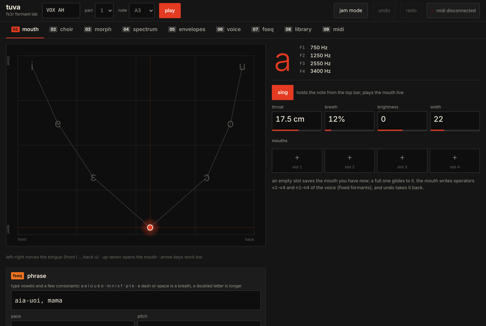
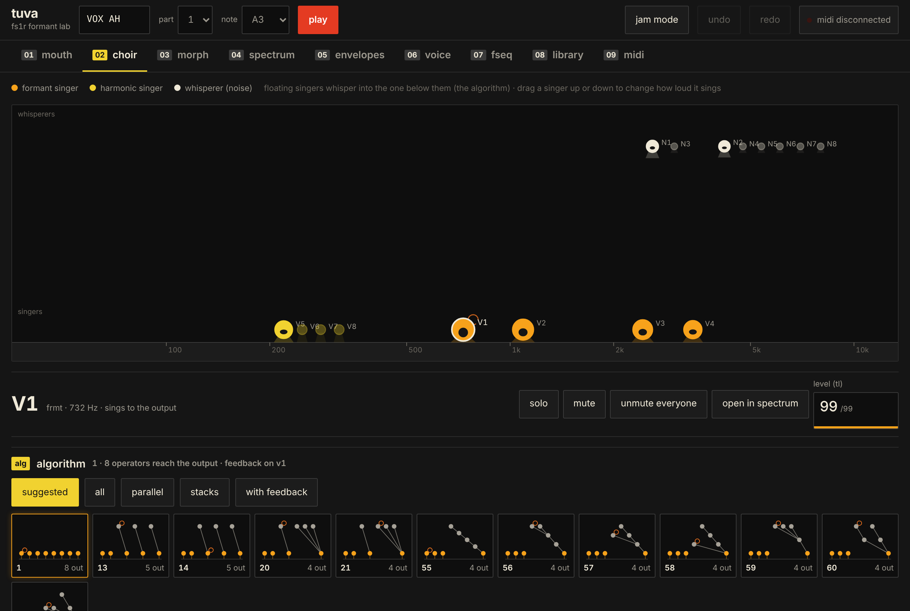
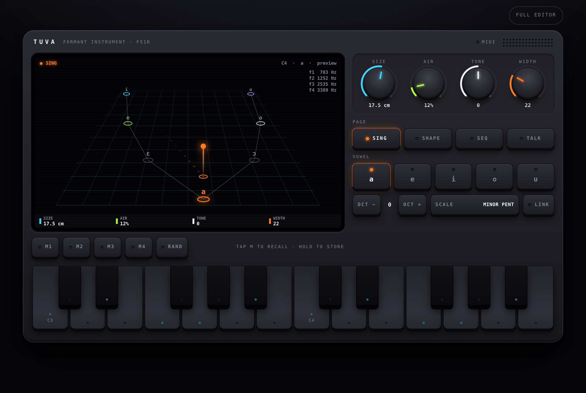

# Tuva — fs1r formant lab

A browser editor and instrument for the **Yamaha FS1R**, the 1998 formant-shaping FM synth that is famously hard to program from its front panel.

Tuva puts the FS1R's real idea back in front of you: it is a throat. Instead of starting from 16 operators and 88 numbered algorithms, you start from a mouth.

**Use it here:** https://phonk.github.io/tuva/

## What's inside

| Page | What it does |
|---|---|
| **Mouth** | Drag across a vowel plane (i e ɛ a ɔ o u). Throat length, breath, brightness and width shape all formants at once. Four mouth memories that glide into each other. |
| **Phrase** | Type vowels and a few consonants (`aia-uoi, mama`), or record a gesture on the vowel plane, and Tuva builds an Fseq from it. |
| **Choir** | The 8 voiced and 8 unvoiced operators as singers on a stage, placed by frequency. Modulators float above the operator they modulate. Solo, mute, drag to set level. All 88 algorithms drawn as diagrams, with suggestions for the current voice. |
| **Morph** | Four mouths in the corners of a pad; slide between them while playing a keyboard in scale. |
| **Spectrum, Envelopes, Voice, Fseq** | Every voice parameter, drawn: formants as hills you can drag, envelopes as points, the Fseq as a timeline you can draw on or build from an audio file. |
| **Library, MIDI** | Import and export `.syx` (voices, banks, Fseqs), save to a library in the browser, send and request dumps, a live SysEx log. |
| **Jam mode** | A simpler, self-contained instrument: four pages (sing, shape, a 16-step vowel sequencer, talk), four encoders whose job follows the page, a two-octave keyboard. |

## Connecting an FS1R

1. Open the page in **Chrome or Edge** on a computer with a MIDI interface connected to the FS1R (MIDI In and Out).
2. On the FS1R, set *Receive System Exclusive* on and note the Device Number.
3. In Tuva, open **MIDI**, press **Connect MIDI**, allow SysEx access, choose the ports and the device number.
4. **Request part voice** loads the voice from the synth; from then on every edit is sent live.

Safari and Firefox do not support Web MIDI with SysEx reliably. Everything except talking to the synth works in any modern browser, with an approximate audio preview.

## Status

Tuva was tested against [FSVR](https://github.com/musicastudio/FSVR), a software reconstruction of the FS1R: voice dumps round-trip byte for byte, parameter changes land on the right bytes (including packed ones), formant frequencies and algorithm routing measure as expected, and Fseqs load and play. It has **not yet been tested on a hardware FS1R**. If you have one, reports are very welcome in the Issues.

Known limits: the FS1R steps an Fseq at most once every ~5.2 ms (192 Hz), so a full-resolution Fseq lasts about 2.7 s; the audio preview is an approximation, not an FS1R emulation.

## Credits

By **Alessandro Bonino and Claude**.

- SysEx formats and parameter tables: Yamaha FS1R *Data List*.
- Algorithm connection table, Fseq frame layout and frequency/level scales: from the reverse engineering in [FSVR](https://github.com/musicastudio/FSVR) by musicastudio (GPL-3.0).

## License

GPL-3.0, see [LICENSE](LICENSE).
